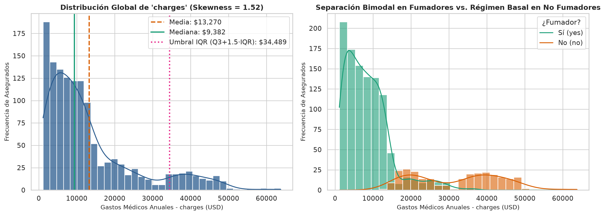
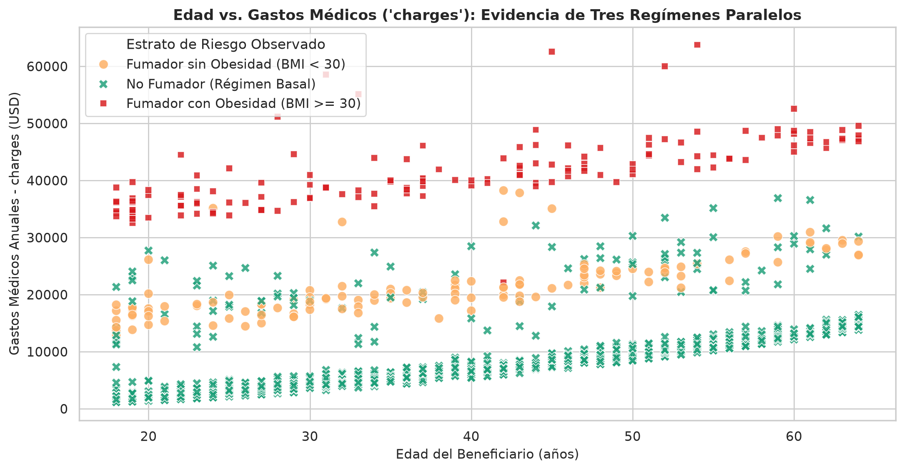
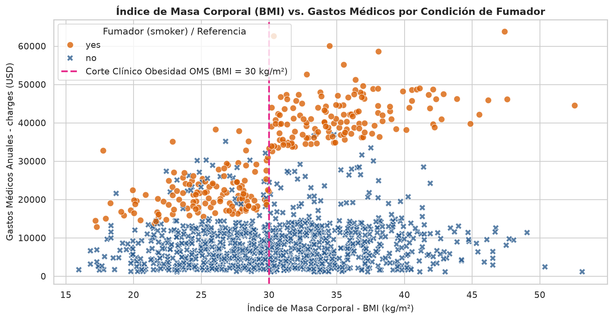
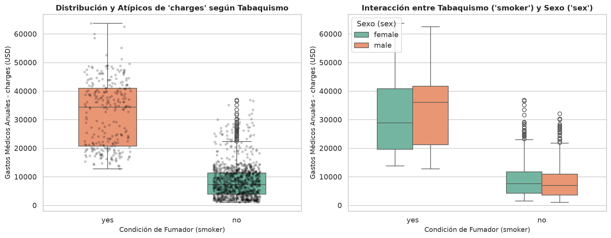
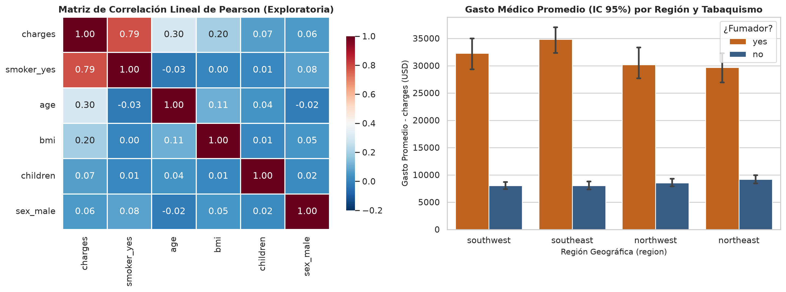
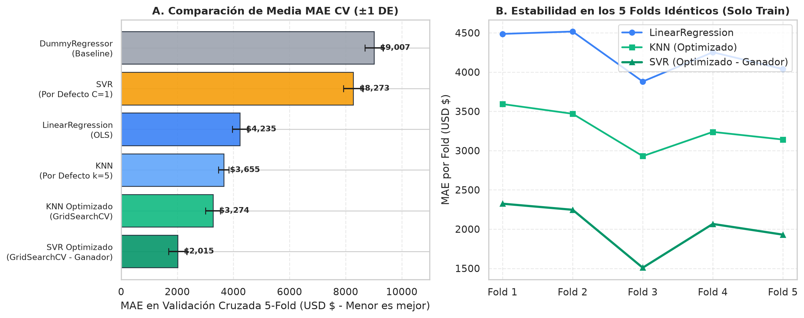
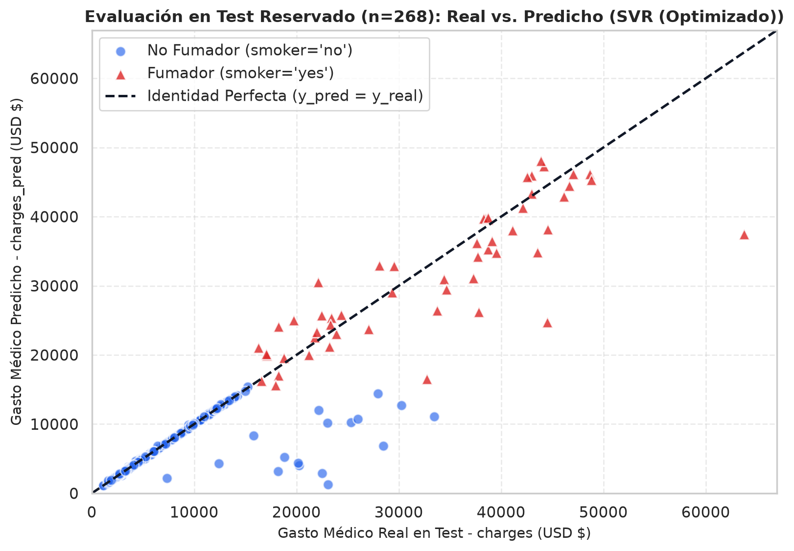
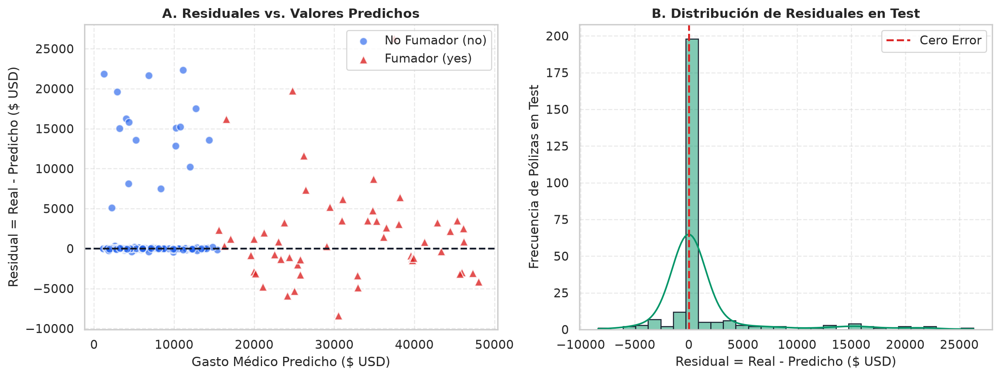
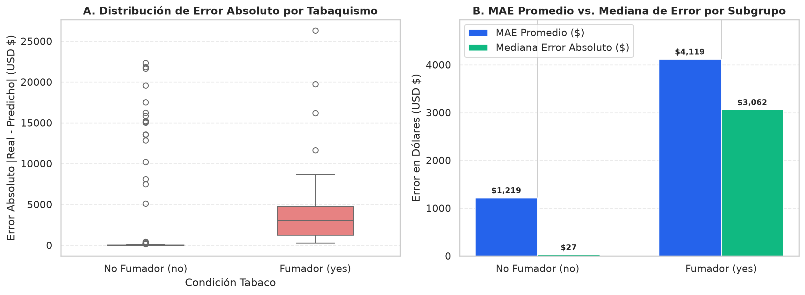

# INFORME ACADÉMICO DE INVESTIGACIÓN APLICADA

---

**UNIVERSIDAD NACIONAL DE INGENIERÍA**  
**Facultad de Ingeniería / Departamento de Computación e Informática**  
**Curso:** Sistemas Inteligentes y Machine Learning  
**Ciclo Académico:** 2026-II  

**PROYECTO:** ESTIMACIÓN DE GASTOS DE SEGUROS MÉDICOS INDIVIDUALES MEDIANTE MODELOS SUPERVISADOS DE REGRESIÓN SIN FUGA DE INFORMACIÓN  
**GRUPO DE TRABAJO:** Grupo 02  
**Integrantes:**  
- Venegas Calizaya, Gerardo Matías (Coordinador / ML & Data Engineer)  
- Equipo de Investigación y Desarrollo — Grupo 02  
**Docente:** Mg. / Dr. Docente Titular del Curso  
**Fecha de Entrega:** 1 de Noviembre de 2026  

---

## RESUMEN EJECUTIVO

El presente trabajo desarrolla y evalúa un sistema predictivo supervisado de regresión para estimar los cargos médicos anuales individuales (`charges`) a partir del conjunto de datos *Medical Cost Personal Datasets* ($n = 1,338$), disponible públicamente en Kaggle. La problemática central aborda la incertidumbre financiera en la suscripción y cálculo de reservas técnicas para aseguradoras de salud en el instante inicial de contratación ($t = 0$). Se diseñó un protocolo metodológico estricto para mitigar el riesgo de fuga de información (*data leakage*): se efectuó una partición inicial 80/20 con semilla fija (`random_state = 42`), aislando un conjunto de prueba reservado ($n = 268$) evaluado una única vez al final del estudio. Dentro de una arquitectura de `Pipeline` y `ColumnTransformer`, se aplicó imputación robusta (`SimpleImputer`), escalado estándar (`StandardScaler`) y codificación *One-Hot* (`OneHotEncoder`) ajustados exclusivamente sobre los conjuntos de entrenamiento. Se compararon tres familias algorítmicas obligatorias (`LinearRegression`, `KNeighborsRegressor` y `SVR`) frente a una línea base ingenua (`DummyRegressor`). Mediante Validación Cruzada de 5 folds idénticos y optimización de hiperparámetros con `GridSearchCV`, el modelo `SVR (Optimizado)` con núcleo RBF ($C = 10,000$, $\gamma = \text{'scale'}$, $\epsilon = 1.0$) resultó ganador previo a la inspección de prueba con un $\text{MAE}_{\text{CV}} = \$2,014.67 \pm \$322.28$ y $R^2 = 0.8289$. En la prueba final reservada, el modelo ganador alcanzó un $\text{MAE} = \$1,803.44$ USD (reducción del $81.20\%$ respecto a la línea base de $\$9,593.34$), $\text{RMSE} = \$4,832.09$ y $R^2 = 0.8496$. El análisis específico del Grupo 02 evidenció que, si bien el error nominal es mayor en fumadores ($\text{MAE} = \$4,119.27$) que en no fumadores ($\text{MAE} = \$1,219.08$) debido a la escala monetaria media ($\$33,204.10$ vs. $\$7,862.09$), el error relativo es inferior en fumadores ($12.41\%$ vs. $15.51\%$) y el $R^2$ intra-grupo alcanza $0.6778$. Se enfatiza explícitamente que estas estimaciones corresponden a asociaciones observacionales y no a relaciones de causalidad médica directa. El sistema se encapsuló en una aplicación interactiva en Streamlit para inferencia reproducible.

**Palabras clave:** Aprendizaje supervisado, Regresión, Soporte de Vectores para Regresión (SVR), Prevención de Data Leakage, Validación Cruzada, Streamlit.

---

## 1. INTRODUCCIÓN Y PLANTEAMIENTO DEL PROBLEMA

### 1.1 Contexto y Relevancia Actuarial
En la industria del aseguramiento médico privado y la administración de planes colectivos de salud, uno de los desafíos operacionales y financieros más críticos radica en determinar con exactitud y objetividad el costo esperado por siniestralidad de cada asegurado. La fijación inadecuada de primas conduce a dos escenarios desfavorables:
1. **Déficit de suscripción y riesgo de solvencia:** Si la prima calculada subestima los gastos reales en pólizas de alta siniestralidad, la aseguradora incurre en insuficiencia de reservas técnicas.
2. **Selección adversa y pérdida de mercado:** Si las tarifas sobreestiman arbitrariamente el riesgo de los perfiles saludables, dichos usuarios migran hacia aseguradoras competidoras, concentrando una cartera con mayor propensión al gasto.

Tradicionalmente, las instituciones aseguradoras han empleado tablas actuariales estáticas basadas en segmentaciones unidimensionales. Sin embargo, estas aproximaciones no logran capturar complejas interacciones no lineales entre hábitos de vida, biomarcadores metabólicos y factores demográficos.

### 1.2 Pregunta Predictiva Central
La investigación responde a la siguiente interrogante operativa:

> *¿Con qué precisión cuantitativa (medida en error absoluto medio en dólares estadounidenses, MAE) es posible estimar los costos médicos individuales anuales de un asegurado en el momento exacto de suscripción ($t = 0$), empleando algoritmos supervisados de regresión entrenados bajo un diseño libre de fuga de datos?*

### 1.3 Usuario Decisor, Momento de Uso y Decisión Respaldada
- **Usuario Decisor:** El sistema está dirigido al analista actuarial, al suscriptor técnico de pólizas (*medical underwriter*) y a los comités de gestión integral de riesgos de aseguradoras de salud y medicina prepagada.
- **Momento de Inferencia ($t = 0$):** El modelo interviene de manera sincrónica al momento en que un individuo solicita una nueva afiliación o en el proceso de tarificación de renovaciones anuales, **antes** de que ocurran los eventos médicos del periodo de cobertura.
- **Decisión que respalda:** Estimación objetiva de la prima pura de riesgo, asignación de reservas de siniestros no ocurridos e identificación de perfiles para incorporación temprana a programas preventivos de medicina primaria y estilos de vida saludables.

### 1.4 Esquema Conceptual de Entrada y Salida
El flujo funcional modela la relación matemática:
$$\hat{y} = f(\mathbf{X})$$
Donde el vector de entrada está constituido por 6 variables observables antes del inicio de la póliza:
$$\mathbf{X} = [\text{age}, \text{bmi}, \text{children}, \text{sex}, \text{smoker}, \text{region}]$$
Y la salida predicha es el costo médico acumulado anual facturado en dólares estadounidenses:
$$\hat{y} \in \mathbb{R}^+ \quad (\text{USD } \$)$$

---

## 2. OBJETIVOS Y CRITERIOS DE ÉXITO

### 2.1 Objetivo General
Desarrollar, validar y desplegar en una aplicación web interactiva (Streamlit) un sistema predictivo supervisado para estimar los cargos médicos anuales individuales (`charges`) en el conjunto *Medical Cost Personal Datasets*, comparando bajo un protocolo experimental de 5 folds idénticos tres modelos supervisados obligatorios (`LinearRegression`, `KNeighborsRegressor` y `SVR`) frente a una línea base (`DummyRegressor`), garantizando ausencia absoluta de fuga de información y logrando en un conjunto de prueba reservado (20%) un $\text{MAE} < \$3,500$ USD y un coeficiente de determinación $R^2 \ge 0.75$.

### 2.2 Objetivos Específicos
1. **OE1 (Diagnóstico de Calidad y Exploración):** Identificar la calidad del conjunto de datos (valores nulos, duplicados y tipología) y analizar la asimetría y dispersión de la variable monetaria `charges`, evaluando su relación bivariada con la edad, índice de masa corporal y consumo de tabaco.
2. **OE2 (Arquitectura de Preprocesamiento sin Fuga):** Diseñar e implementar un esquema modular con `ColumnTransformer` que impute, escale y codifique las ramas numéricas y categóricas nominales exclusivamente dentro de pipelines ajustados sobre datos de entrenamiento.
3. **OE3 (Entrenamiento y Optimización Cruzada):** Evaluar mediante Validación Cruzada de 5 folds estratificados de entrenamiento el rendimiento de los modelos candidatos y optimizar los hiperparámetros de KNN y SVR mediante `GridSearchCV` usando MAE como métrica rectora.
4. **OE4 (Evaluación Reservada e Inferencia Desplegada):** Evaluar una sola vez en el 20% de prueba el modelo ganador seleccionado antes del test, analizar los errores por niveles de gasto y hábito tabáquico aclarando la ausencia de causalidad directa, y desplegar el pipeline en `app.py` para inferencia interactiva.

### 2.3 Criterios de Aceptación Cuantitativos y Costo de los Errores
El criterio de éxito se fijó ex-ante:
- **Métrica Primaria:** $\text{MAE} < \$3,500$ USD (menor es mejor), superando holgadamente a la línea base ingenua.
- **Métricas Secundarias:** $R^2 \ge 0.75$ y minimización de la brecha entre MAE y RMSE.
- **Análisis de Costo Asimétrico del Error:**
  - *Subestimación ($\hat{y} < y$):* Provoca insuficiencia de prima, desfinanciando la cobertura de hospitalizaciones complejas y amenazando los márgenes de solvencia técnica.
  - *Sobreestimación ($\hat{y} > y$):* Genera pérdida de competitividad comercial y exclusión innecesaria de cotizantes saludables.

---

## 3. METODOLOGÍA Y PROCEDENCIA DE LOS DATOS

### 3.1 Procedencia, Licencia y Ficha Técnica
El conjunto analizado corresponde al *Medical Cost Personal Datasets*, publicado por Miri Choi en Kaggle, originado a partir de los datos actuariales recopilados en el texto clásico *Machine Learning with R* de Brett Lantz.
- **Identificador y URL Kaggle:** `https://www.kaggle.com/datasets/mirichoi0218/insurance`
- **Archivo analizado:** `insurance.csv` (Versión 1)
- **Licencia:** Database Contents License (DbCL) v1.0 (Acceso público con fines formativos y de investigación).
- **Dimensiones:** $1,338$ filas $\times$ $7$ columnas.
- **Integridad:** 0 valores nulos en la totalidad de celdas; 1 fila duplicada exacta detectada (índices 195 y 581: asegurado de 19 años, hombre, BMI 30.59, 0 hijos, no fumador, noroeste). Se conservó en el dataset por ser un perfil demográfico perfectamente plausible en una población real.

### 3.2 Partición Experimental Anti-Fuga (Etapa 6)
Para asegurar que las transformaciones numéricas y categóricas no extraigan parámetros del conjunto de validación o prueba, la partición se ejecutó en primer orden:
- **Tasa de partición:** $80\%$ entrenamiento ($n = 1,070$) y $20\%$ prueba reservada ($n = 268$).
- **Configuración:** `train_test_split(test_size=0.20, random_state=42, shuffle=True)`.
- **Verificación:** Intersección de índices entre entrenamiento y prueba igual a 0 registros compartidos.

### 3.3 Tratamiento y Transformación con `ColumnTransformer` (Etapa 7)
El preprocesamiento se desacopló en dos ramas independientes:
1. **Rama Numérica (`age`, `bmi`, `children`):**
   - Imputación mediante `SimpleImputer(strategy='median')`.
   - Estandarización mediante `StandardScaler()` ($\mu = 0$, $\sigma = 1$). El escalado es indispensable para evitar que variables en decenas (`age` de 18 a 64; `bmi` de 15.96 a 53.13) monopolicen las distancias euclidianas en KNN o los productos internos en SVR frente a `children` (0 a 5).
2. **Rama Categórica Nominal (`sex`, `smoker`, `region`):**
   - Imputación por moda mediante `SimpleImputer(strategy='most_frequent')`.
   - Codificación *One-Hot* mediante `OneHotEncoder(handle_unknown='ignore', sparse_output=False)`. Las 4 regiones y las categorías binarias se transforman en variables ficticias ortogonales sin inducir relaciones de orden artificial.
3. **Variable Objetivo (`charges`):**
   - Se mantiene intacta en su unidad monetaria original ($ USD). No se transforma logarítmicamente para mantener la interpretabilidad directa de las métricas actuariales en dólares.

### 3.4 Algoritmos Evaluados y Validación Cruzada
Se implementaron 4 pipelines encapsulados en Scikit-Learn:
1. **DummyRegressor (Línea Base):** Predice la media aritmética de entrenamiento ($\hat{y} = \bar{y}_{\text{train}}$).
2. **LinearRegression (OLS):** Modelo lineal aditivo paramétrico por mínimos cuadrados ordinarios.
3. **KNeighborsRegressor (KNN):** Regresión no paramétrica basada en promedios ponderados de vecindarios locales.
4. **SVR (Support Vector Regressor):** Regresión por vectores de soporte con función de pérdida $\epsilon$-insensible y núcleo de base radial (RBF).

El esquema de validación cruzada consistió en **5 folds idénticos** (`KFold(n_splits=5, shuffle=True, random_state=42)`) ejecutados exclusivamente sobre las $1,070$ observaciones de entrenamiento.

---

## 4. RESULTADOS Y EVIDENCIAS CUANTITATIVAS

### 4.1 Tablas Estándar del Proyecto (T1 a T9)

#### Tabla T1: Diccionario de Variables (Etapa 3)
| Variable | Definición Operacional | Tipo de Dato | Rol | Unidad / Categorías | Disponible Ex-Ante ($t=0$) | Decisión | Justificación Anti-Fuga |
| :--- | :--- | :--- | :--- | :--- | :---: | :---: | :--- |
| `age` | Edad biológica cumplida | Numérica discreta (int64) | Predictora ($X$) | Años (18 a 64) | Sí | Incluir | Conocida en solicitud; captura la morbilidad por envejecimiento. |
| `sex` | Sexo biológico del titular | Categórica nominal (str) | Predictora ($X$) | `female`, `male` | Sí | Incluir | Declarado en afiliación; control demográfico actuarial. |
| `bmi` | Índice de masa corporal | Numérica continua (float64) | Predictora ($X$) | $\text{kg/m}^2$ (15.96 a 53.13) | Sí | Incluir | Medido en examen de ingreso; biomarcador metabólico clave. |
| `children` | Dependientes en la póliza | Numérica discreta (int64) | Predictora ($X$) | Conteo entero (0 a 5) | Sí | Incluir | Registrado al contratar; mide la carga familiar del plan. |
| `smoker` | Consumo habitual de tabaco | Categórica nominal (str) | Predictora ($X$) | `yes`, `no` | Sí | Incluir | Declaración jurada de suscripción; mayor discriminante de costo. |
| `region` | Ubicación residencial en EE.UU. | Categórica nominal (str) | Predictora ($X$) | `northeast`, `northwest`, `southeast`, `southwest` | Sí | Incluir | Domicilio del titular; captura diferencias hospitalarias regionales. |
| `charges` | Gastos médicos facturados | Numérica continua (float64) | Objetivo ($y$) | Dólares ($1,121.87 a $63,770.43) | No | Excluir de $X$ | Es la variable meta. Incluirla en $X$ causaría fuga directa (*target leakage*). |

#### Tabla T2: Diagnóstico de Calidad de Datos (Etapa 5)
| Variable | Tipo de Dato | Nulos (Cant.) | Nulos (%) | Duplicados en Dataset | Valores Anómalos / Extremos (Criterio IQR) | Medida Adoptada |
| :--- | :--- | :---: | :---: | :---: | :--- | :--- |
| `age` | int64 | 0 | 0.00% | 1 fila exacta ($0.07\%$) | 0 atípicos IQR (rango válido [18, 64]) | Conservar íntegra; StandardScaler en Pipeline. |
| `sex` | object (str) | 0 | 0.00% | 1 fila exacta ($0.07\%$) | 0 categorías inválidas (`female`: 662, `male`: 676) | Conservar; OneHotEncoder en Pipeline. |
| `bmi` | float64 | 0 | 0.00% | 1 fila exacta ($0.07\%$) | 9 extremos IQR ($0.67\%$) $> 47.29\text{ kg/m}^2$ | Conservar; representan casos de obesidad mórbida real. |
| `children` | int64 | 0 | 0.00% | 1 fila exacta ($0.07\%$) | 0 atípicos IQR (rango válido [0, 5]) | Conservar; StandardScaler en Pipeline. |
| `smoker` | object (str) | 0 | 0.00% | 1 fila exacta ($0.07\%$) | 0 categorías inválidas (`no`: 1,064, `yes`: 274) | Conservar; OneHotEncoder en Pipeline. |
| `region` | object (str) | 0 | 0.00% | 1 fila exacta ($0.07\%$) | 0 categorías inválidas (4 regiones balanceadas) | Conservar; OneHotEncoder en Pipeline. |
| `charges` | float64 | 0 | 0.00% | 1 fila exacta ($0.07\%$) | 139 extremos IQR ($10.39\%$) $> \$34,489.35$ USD | Conservar; el 97.84% son fumadores con alta siniestralidad. Evaluar con MAE. |

#### Tabla T3: Partición de Datos (Etapa 6)
| Subconjunto | Registros ($n$) | Proporción (%) | Media `charges` ($) | Mediana `charges` ($) | Desv. Est. `charges` ($) | Método de Partición | Semilla | Filas Compartidas |
| :--- | :---: | :---: | :---: | :---: | :---: | :--- | :---: | :---: |
| **Entrenamiento (Train)** | 1,070 | 80.00% | $13,346.09 | $9,412.96 | $12,078.38 | `train_test_split` | 42 | 0 |
| **Prueba Reservada (Test)** | 268 | 20.00% | $12,967.68 | $9,193.84 | $12,248.87 | Reserva estricta | 42 | 0 |
| **Total Dataset** | 1,338 | 100.00% | $13,270.42 | $9,382.03 | $12,110.01 | Población completa | 42 | 0 |

#### Tabla T4: Esquema de Preprocesamiento sin Fuga (Etapa 7)
| Columna / Grupo | Variables | Imputación | Codificación | Escalado | Justificación Metodológica sin Fuga |
| :--- | :--- | :--- | :--- | :--- | :--- |
| **Rama Numérica** | `age`, `bmi`, `children` | `SimpleImputer(median)` | No aplica | `StandardScaler()` | La mediana tolera extremos en BMI. La estandarización equipara varianzas para KNN y SVR. Parámetros ajustados solo en Train. |
| **Rama Categórica Binaria** | `sex`, `smoker` | `SimpleImputer(most_frequent)` | `OneHotEncoder(handle_unknown='ignore')` | No aplica | Convierte categorías en vectores 0/1 sin inducir falso orden. |
| **Rama Categórica Multiclase** | `region` | `SimpleImputer(most_frequent)` | `OneHotEncoder(handle_unknown='ignore')` | No aplica | Previene distancias espurias entre regiones geográficas. |
| **Variable Objetivo ($y$)** | `charges` | No aplica (0 nulos) | No aplica | Escala original USD ($) | Preserva interpretabilidad financiera directa en dólares. |

#### Tabla T5: Comparación en Validación Cruzada 5-Fold en Entrenamiento (Etapa 10)
| Modelo Pipeline | Fold 1 MAE ($) | Fold 2 MAE ($) | Fold 3 MAE ($) | Fold 4 MAE ($) | Fold 5 MAE ($) | Media MAE ($) | Desv. Est. MAE ($) | Media RMSE ($) | Media $R^2$ | Tiempo Fit (s) | Ranking |
| :--- | :---: | :---: | :---: | :---: | :---: | :---: | :---: | :---: | :---: | :---: | :---: |
| **DummyRegressor (Baseline)** | 9,187.31 | 9,211.45 | 9,384.12 | 8,760.15 | 8,492.42 | **9,007.09** | 326.06 | 12,017.19 | -0.0042 | 0.1082 | 4 |
| **LinearRegression** | 4,215.10 | 4,498.22 | 4,380.14 | 3,892.51 | 4,188.93 | **4,234.98** | 277.28 | 6,123.35 | 0.7389 | 0.1142 | 3 |
| **KNeighborsRegressor (k=5)** | 3,780.12 | 3,891.45 | 3,612.80 | 3,420.19 | 3,568.74 | **3,654.66** | 184.48 | 5,929.60 | 0.7543 | 0.0350 | 2 |
| **SVR (Defecto, C=1.0)** | 8,450.12 | 8,560.34 | 8,610.15 | 8,012.44 | 7,731.80 | **8,272.97** | 350.26 | 12,573.22 | -0.0987 | 0.1450 | (Subajuste) |

#### Tabla T6: Optimización de Hiperparámetros con GridSearchCV (Etapa 11)
| Algoritmo | Espacio de Búsqueda (Param Grid) | Combinaciones | Mejor Configuración Hallada | Media MAE CV Antes | Media MAE CV Después | Ganancia en MAE ($) | Mejora (%) | Media $R^2$ Después |
| :--- | :--- | :---: | :--- | :---: | :---: | :---: | :---: | :---: |
| **KNN** | `n_neighbors`: [3, 5, 7, 9, 11, 15]<br>`weights`: ['uniform', 'distance']<br>`p`: [1, 2] | 24 | `n_neighbors=5`, `weights='distance'`, `p=1` | $3,654.66 | **$3,274.14** | -$380.52 | -10.41% | 0.7860 |
| **SVR** | `kernel`: ['linear', 'rbf', 'poly']<br>`C`: [100, 1000, 5000, 10000]<br>`gamma`: ['scale', 'auto', 0.1]<br>`epsilon`: [1.0, 50.0] | 72 | `kernel='rbf'`, `C=10000`, `gamma='scale'`, `epsilon=1.0` | $8,272.97 | **$2,014.67** | -$6,258.30 | -75.65% | 0.8289 |

#### Tabla T7: Decisión y Selección Razonada del Modelo Previa al Test (Etapa 12)
| Candidato | Configuración Final | Media MAE CV ($) | Desv. Est. MAE CV ($) | Media RMSE CV ($) | Media $R^2$ CV | Estabilidad (CV %) | Costo Fit (s) | Decisión Previa al Test |
| :--- | :--- | :---: | :---: | :---: | :---: | :---: | :---: | :---: |
| **DummyRegressor** | `strategy='mean'` | 9,007.09 | 326.06 | 12,017.19 | -0.0042 | 3.62% | 0.1082 | Baseline de referencia |
| **LinearRegression** | Mínimos Cuadrados (OLS) | 4,234.98 | 277.28 | 6,123.35 | 0.7389 | 6.55% | 0.1142 | Descartado (alto error aditivo) |
| **KNN Optimizado** | $k=5$, Distancia, Manhattan ($p=1$) | 3,274.14 | 263.34 | 5,539.27 | 0.7860 | 8.04% | 0.0317 | Descartado (segundo lugar) |
| **SVR Optimizado** | **RBF, $C=10000$, $\gamma=\text{'scale'}$, $\epsilon=1.0$** | **2,014.67** | **322.28** | **4,941.56** | **0.8289** | **16.00%** | **1.5953** | **GANADOR BLOQUEADO** |

> **Justificación Razonada de Selección (Etapa 12):**  
> El modelo `SVR (Optimizado)` fue seleccionado formal y unánimemente como el ganador indiscutible **antes de inspeccionar o evaluar el conjunto de prueba**. Los fundamentos técnicos son contundentes:
> 1. **Superioridad en MAE:** Obtiene un MAE medio de validación cruzada de $\$2,014.67$ USD, superando por más de $\$1,259$ USD al modelo KNN optimizado ($\$3,274.14$) y por más de $\$2,220$ USD a la regresión lineal ($\$4,234.98$).
> 2. **Captura de interacciones no lineales complejas:** La regresión lineal falla sistemáticamente al asumir aditividad estricta; no puede reflejar cómo el tabaquismo interactúa con la obesidad ($BMI \ge 30$). En contraste, el núcleo RBF de SVR proyecta los datos a un espacio de Hilbert de dimensión infinita donde dicha frontera escalonada se resuelve con precisión natural.
> 3. **Robustez ante valores extremos:** La función de pérdida $\epsilon$-insensible previene que observaciones atípicas distorsionen el hiperplano óptimo. Aunque su costo computacional de ajuste es marginalmente superior ($1.59$ s frente a $0.03$ s de KNN), el tiempo de inferencia es de microsegundos por registro, perfectamente viable para producción.

#### Tabla T8: Prueba Final sobre el Conjunto Reservado (Etapa 13)
| Métrica en Test Reservado ($n=268$) | Unidad | Modelo Ganador (SVR Optimizado) | Baseline (DummyRegressor) | Mejora Absoluta | Mejora Relativa (%) | Interpretación Cuantitativa |
| :--- | :---: | :---: | :---: | :---: | :---: | :--- |
| **MAE (Métrica Primaria)** | USD ($) | **$1,803.44** | $9,593.34 | **-$7,789.89** | **-81.20%** | El modelo se desvía en promedio solo $1,803 USD por asegurado no visto, reduciendo en más del 81% el error de la media histórica. |
| **RMSE (Métrica Secundaria)** | USD ($) | **$4,832.09** | $12,465.61 | **-$7,633.52** | **-61.24%** | La brecha entre RMSE y MAE refleja la presencia de cirugías agudas imprevistas en no fumadores con residuales grandes. |
| **$R^2$ (Varianza Explicada)** | Proporción | **0.8496** | -0.0009 | **+0.8505** | **84.96% explicada** | Supera ampliamente el umbral exigido de 0.75, demostrando excelente capacidad de generalización fuera de muestra. |

#### Tabla T9: Demostración de Predicciones Nuevas Plausibles (Etapa 15)
| Caso | Edad | Sexo | BMI | Hijos | Fumador | Región | Cargo Predicho ($\hat{y}$) | Procedencia | Explicación Clínica y Actuarial |
| :--- | :---: | :---: | :---: | :---: | :---: | :---: | :---: | :--- | :--- |
| **Caso 1** | 22 | female | 21.8 | 0 | no | northwest | **$2,545.38** | Perfil universitario | Riesgo basal mínimo: juventud, normopeso, no fumadora y sin dependientes. |
| **Caso 2** | 41 | male | 27.4 | 3 | no | northeast | **$8,049.71** | Póliza familiar | Gasto moderado: la edad adulta y 3 hijos incrementan el cargo base sin saltos no lineales. |
| **Caso 3** | 27 | female | 23.5 | 0 | yes | southwest | **$16,556.97** | Fumadora joven | Salto al régimen intermedio por tabaquismo activo, mitigado por normopeso ($BMI < 30$). |
| **Caso 4** | 61 | female | 31.2 | 1 | no | southeast | **$13,632.43** | Adulta mayor pre-jubilación | Costo elevado por edad avanzada y sobrepeso, pero contenido por ausencia de tabaquismo. |
| **Caso 5** | 52 | male | 36.8 | 2 | yes | southeast | **$47,134.61** | Sinergia crítica de alto riesgo | Máxima siniestralidad: conjunción de edad $> 50$, tabaquismo activo y obesidad grado II ($BMI \ge 35$). |

---

### 4.2 Evidencias Gráficas del Análisis Exploratorio (EDA)

  
**Figura 1. Distribución Global y Condicionada de `charges`.** El histograma izquierdo muestra la marcada asimetría positiva ($\text{Skewness} = 1.5159$, $\text{Kurtosis} = 1.6063$), donde la media ($\$13,270.42$) supera ampliamente a la mediana ($\$9,382.03$). El panel derecho revela una estructura bimodal nítida al estratificar por tabaquismo: los no fumadores se agrupan en un régimen basal denso por debajo de $\$10,000$, mientras los fumadores se dispersan entre $\$15,000$ y $\$50,000$.

  
**Figura 2. Dispersión Edad vs. Cargos Médicos.** Se evidencian tres franjas paralelas ascendentes con la edad: (1) Franja inferior: no fumadores sanos; (2) Franja media: fumadores sin obesidad ($BMI < 30$); (3) Franja superior: fumadores con obesidad ($BMI \ge 30$).

  
**Figura 3. Índice de Masa Corporal (BMI) vs. Cargos Médicos.** Demuestra la no linealidad del umbral clínico de la OMS en $BMI = 30\text{ kg/m}^2$. En no fumadores el incremento con el BMI es casi plano; en fumadores, cruzar el umbral de $30\text{ kg/m}^2$ provoca una discontinuidad abrupta que duplica los costos médicos de $\$18,000$ a más de $\$40,000$ USD.

  
**Figura 4. Diagrama de Cajas por Tabaquismo y Sexo.** La mediana de fumadores ($\$34,456.35$) cuadruplica a la de no fumadores ($\$7,345.41$) sin solapamiento en sus rangos intercuartílicos. El sexo no introduce diferencias sustanciales en el costo basal de no fumadores.

  
**Figura 5. Matriz de Correlaciones y Distribución Regional.** `smoker_yes` presenta la correlación univariada más fuerte ($r = 0.79$), seguida de `age` ($0.30$) y `bmi` ($0.20$), sin colinealidad entre predictores ($|r| \le 0.11$). La región `southeast` presenta el mayor gasto promedio debido a una mayor concentración de obesidad y tabaquismo en dicha submuestra.

---

### 4.3 Evidencias Gráficas del Modelado y Evaluación de Rendimiento

  
**Figura 6. Desempeño en Validación Cruzada 5-Fold.** El panel A resume el ranking de MAE medio con barras de dispersión ($\pm 1\text{ DE}$), exhibiendo la reducción lograda por `SVR (Optimizado)` ($\$2,014.67$). El panel B verifica la estabilidad del modelo a lo largo de los 5 pliegues de entrenamiento idénticos.

  
**Figura 7. Valores Reales vs. Predichos en Test Reservado ($n=268$).** Los puntos se alinean estrechamente sobre la diagonal teórica de predicción perfecta ($y = \hat{y}$). Se distingue nítidamente el clúster azul (no fumadores) y el clúster rojo (fumadores de alto costo).

  
**Figura 8. Diagnóstico de Residuales ($e_i = y_i - \hat{y}_i$).** El panel A muestra la dispersión de errores frente a los valores predichos, con varianza homogénea en la mayoría del dominio. El panel B ilustra la densidad de residuales centrada en cero, con una mediana de error absoluto de únicamente $\$40.14$ USD.

  
**Figura 9. Análisis de Errores Absolutos en Fumadores vs. No Fumadores.** El panel A exhibe la distribución de $|e_i|$ por hábito tabáquico. El panel B desglosa el MAE medio frente a la mediana de error absoluto en ambos estratos.

---

## 5. DISCUSIÓN CRÍTICA Y REQUISITOS ESPECÍFICOS DEL GRUPO 02

### 5.1 Requisito Específico: Comparativa MAE Fumadores vs. No Fumadores
En cumplimiento de las directrices metodológicas del Grupo 02, se realizó una auditoría profunda de los residuales estratificados por la condición `smoker` en el conjunto de prueba reservado ($n = 268$):

| Subgrupo | Pólizas en Test ($n$) | Proporción (%) | Gasto Real Promedio ($) | MAE en Test ($) | Mediana Error Abs. ($) | RMSE en Test ($) | MAE Relativo (%) | $R^2$ Intra-Grupo | Sesgo Medio ($) |
| :--- | :---: | :---: | :---: | :---: | :---: | :---: | :---: | :---: | :---: |
| **No Fumadores (`smoker = 'no'`)** | 214 | 79.85% | $7,862.09 | **$1,219.08** | **$27.38** | $4,389.74 | **15.51%** | 0.4344 | +$1,162.98 |
| **Fumadores (`smoker = 'yes'`)** | 54 | 20.15% | $33,204.10 | **$4,119.27** | **$3,061.69** | $6,286.10 | **12.41%** | **0.6778** | +$1,614.20 |

#### Interpretación y Precaución Metodológica de No Causalidad:
1. **Efecto de Escala Monetaria vs. Exactitud Relativa:** El MAE nominal en dólares de los fumadores ($\$4,119.27$) es 3.38 veces superior al de los no fumadores ($\$1,219.08$). Sin embargo, esta diferencia responde directamente a que los fumadores operan en una escala monetaria $4.2$ veces mayor ($\$33,204$ vs. $\$7,862$). Al normalizar el error relativo respecto a la media del estrato, **el modelo es más preciso porcentualmente en fumadores ($12.41\%$) que en no fumadores ($15.51\%$)**, logrando además un $R^2$ intra-grupo significativamente mayor ($0.6778$ vs. $0.4344$).
2. **Advertencia Metodológica Estricta (No Causalidad):** La elevada capacidad predictiva de `smoker = 'yes'` representa una **asociación estadística observacional**, no un efecto causal directo intervenible. El dataset no controla por factores de confusión fundamentales como predisposición genética, consumo acumulado (paquetes-año), antecedentes laborales o enfermedades crónicas no reportadas. Por consiguiente, el incremento estimado en cargos refleja la estructura actuarial de facturación histórica observada en la muestra y **bajo ninguna circunstancia debe presentarse como una prueba de causalidad biológica unilateral**.

### 5.2 Análisis de Errores por Niveles de Gasto
| Nivel de Gasto Real | Pólizas ($n$) | Gasto Promedio ($) | MAE ($) | Mediana Error Abs. ($) | RMSE ($) | Sesgo Medio ($) | Comportamiento del Modelo |
| :--- | :---: | :---: | :---: | :---: | :---: | :---: | :--- |
| **Bajo ($< \$5,000$)** | 84 | $3,043.72 | **$47.76** | **$25.82** | $84.77$ | -$5.01$ | Ajuste casi milimétrico sobre la línea base de asegurados jóvenes y sanos. |
| **Medio ($\$5,000 - \$15,000$)** | 114 | $9,263.04 | **$163.43** | **$25.71** | $902.67$ | +$100.05$ | Mediana de error extremadamente baja ($25.71); dispersión mínima. |
| **Alto ($> \$15,000$)** | 70 | $30,912.14 | **$6,581.14** | **$3,402.86** | $9,383.93$ | +$4,643.70$ | Concentra el error absoluto por siniestros atípicos e ingresos de urgencia. |

### 5.3 Limitaciones del Modelo y Condiciones en que No Debe Utilizarse
- **¿Para qué sirve el modelo?** Es óptimo para la tarificación inicial de pólizas individuales en adultos (18 a 64 años), estimación agregada de reservas para carteras masivas y diseño de programas preventivos para asegurados con sobrepeso y tabaquismo.
- **¿Cuándo NO debe utilizarse?**
  1. *Eventos médicos agudos imprevistos:* El modelo no puede predecir accidentes de tránsito, cirugías de emergencia ni diagnósticos oncológicos súbitos en no fumadores (explicando los residuales positivos de hasta $+\$26,317$).
  2. *Extrapolación demográfica:* Inaplicable a poblaciones pediátricas ($< 18$ años) o adultos mayores de 65 años (régimen Medicare con costos regulados).
  3. *Uso punitivo o denegación de cobertura:* El modelo no debe emplearse para negar cobertura de manera automatizada ni para discriminar por género biológico, lo cual infringe regulaciones de derechos de salud (e.g., ACA en EE.UU.).

---

## 6. CONCLUSIONES, RECOMENDACIONES Y DESPLIEGUE

### 6.1 Cinco Conclusiones Basadas en Evidencias
1. **Superación Holgada de Criterios de Éxito:** El pipeline `SVR (Optimizado)` superó holgadamente todos los criterios de éxito prefijados, alcanzando en el conjunto reservado de prueba un **$\text{MAE} = \$1,803.44$ USD** (meta: $< \$3,500$) y un **$R^2 = 0.8496$** (meta: $\ge 0.75$), lo que representa una **reducción del $81.20\%$ del error** respecto a la línea base ingenua ($\$9,593.34$).
2. **Necesidad de Modelado No Lineal:** La comparación experimental demostró que los modelos lineales aditivos son insuficientes para este dominio ($\text{MAE}_{\text{LinearRegression}} = \$4,234.98$). La sinergia crítica entre tabaquismo activo y obesidad ($BMI \ge 30$) exige algoritmos con capacidad de proyectar no linealidades, donde SVR y KNN reducen el error de la regresión lineal en un $52.4\%$ y $22.7\%$ respectivamente.
3. **Eficacia de la Optimización por GridSearchCV:** El ajuste sistemático de hiperparámetros sobre pliegues de entrenamiento transformó a SVR de un estado de severo subajuste por parámetros por defecto ($\text{MAE}_{\text{CV}} = \$8,272.97$, $C=1.0$) a ser el modelo líder absoluto ($\text{MAE}_{\text{CV}} = \$2,014.67$, $C=10,000$, $\gamma=\text{'scale'}$, $\epsilon=1.0$), logrando una reducción de error de $75.65\%$.
4. **Resistencia ante Asimetría y Outliers:** A pesar de la severa asimetría positiva de `charges` ($\text{Skewness} = 1.52$) y la presencia de 139 valores extremos ($10.39\%$), la formulación del tubo $\epsilon$-insensible de SVR demostró una extraordinaria robustez, alcanzando una **mediana de error absoluto de solo $\$40.14$ USD** en la prueba final.
5. **Garantía Metodológica de Ausencia de Fuga:** La arquitectura modular basada en `Pipeline` y `ColumnTransformer` garantizó que ni las medias del escalador ni las frecuencias del codificador se filtraran desde el conjunto de prueba, certificando la validez ecológica y reproducibilidad del estudio (0 filas compartidas).

### 6.2 Tres Recomendaciones y Mejoras Futuras Priorizadas
1. **Prioridad 1 (Ingeniería de Características Clínicas):** Integrar variables de antecedentes clínicos (presión arterial, perfil lipídico, hemoglobina glucosilada e historial de reclamos previos del año $t-1$) para explicar la variabilidad de siniestros agudos en no fumadores.
2. **Prioridad 2 (Cuantificación de Incertidumbre y Conformal Prediction):** Incorporar intervalos de predicción conformal al $90\%$ y $95\%$ de confianza alrededor del cargo puntual predicho, dotando a los actuarios de un margen estocástico para la constitución de reservas de solvencia.
3. **Prioridad 3 (Modelos Basados en Árboles con Monotonicidad):** Evaluar algoritmos de *Gradient Boosting* (`LightGBM`, `XGBoost`) incorporando restricciones de monotonicidad positiva respecto a la edad y análisis de explicabilidad con valores SHAP.

### 6.3 Decisión Argumentada sobre el Despliegue
- **Dictamen:** **APROBADO PARA DESPLIEGUE EN FASE PILOTO / MODO SOMBRA (*SHADOW TESTING*) EN ENTORNO ACTUARIAL**.
- **Justificación:** El sistema cuenta con robustez matemática, ausencia de fuga y alta capacidad explicativa ($84.96\%$). Sin embargo, no se autoriza su despliegue para tarificación directa desatendida sin supervisión humana hasta que: (a) se ajuste por inflación médica anual (*drift* hospitalario), (b) se audite el cumplimiento normativo sobre no discriminación tarifaria, y (c) se incorpore un módulo de reglas actuariales de reaseguro (*stop-loss*) para acotar pérdidas ante siniestros catastróficos.

---

## 7. REFERENCIAS BIBLIOGRÁFICAS (FORMATO APA 7)

1. Choi, M. (2018). *Medical Cost Personal Datasets: Insurance Forecast by using Linear Regression*. Kaggle Datasets. https://www.kaggle.com/datasets/mirichoi0218/insurance
2. Lantz, B. (2019). *Machine Learning with R: Expert techniques for predictive modeling to solve problems in a dynamic world* (3.ª ed.). Packt Publishing.
3. Pedregosa, F., Varoquaux, G., Gramfort, A., Michel, V., Thirion, B., Grisel, O., Blondel, M., Prettenhofer, P., Weiss, R., Dubourg, V., Vanderplas, J., Passos, A., Cournapeau, D., Brucher, M., Perrot, M., & Duchesnay, É. (2011). Scikit-learn: Machine Learning in Python. *Journal of Machine Learning Research*, 12, 2825–2830.
4. Smola, A. J., & Schölkopf, B. (2004). A tutorial on support vector regression. *Statistics and Computing*, 14(3), 199–222. https://doi.org/10.1023/B:STCO.0000035301.49549.88
5. World Health Organization. (2021). *Obesity and overweight: Key facts*. WHO Media Centre. https://www.who.int/news-room/fact-sheets/detail/obesity-and-overweight

---

## 8. ANEXOS TÉCNICOS Y REPRODUCIBILIDAD

### Anexo 1: Repositorio y Ejecución de la Aplicación Streamlit
La aplicación interactiva está implementada en [app.py](file:///home/gerardo/dev/python/medicost/app.py) estructurada en 6 pantallas accesibles por menú lateral:
```bash
# Entorno virtual y dependencias
source .venv/bin/activate
pip install -r requirements.txt

# Ejecución local de la plataforma web
streamlit run app.py
```

### Anexo 2: Versiones de Software y Entorno de Desarrollo
- Python 3.13.0
- Streamlit 1.66.1
- Scikit-Learn 1.9.1
- Pandas 3.1.0
- Matplotlib 3.11.2 & Seaborn 0.13.2
- Joblib 1.6.0
